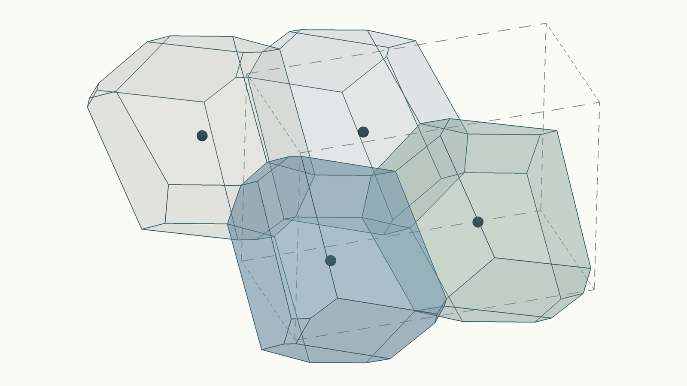

<div class="landing" markdown="1">
<div class="landing-hero" markdown="1">
<div class="landing-intro" markdown="1">

# Voronoi and power tessellations *in Python*

Compute 2D and 3D Voronoi or weighted Laguerre cells, inspect periodic
neighbors, or fit power weights from measured separators at fixed sites.

</div>
<figure class="landing-figure">
  
  <figcaption><strong>Fully periodic triclinic lattice.</strong> Four complete cells sum to one lattice-cell volume (3 cubic units).</figcaption>
</figure>
</div>

<div class="landing-paths" markdown="1">
<section markdown="1">

## [Tessellations &amp; periodic geometry](guide/forward/index.md)

Compute cells and measures from sites in a domain. Follow the triclinic example
to identify the neighbor image across each face.

<div class="landing-links" markdown="1">

[Planar 2D](guide/planar.md)
[Periodic contacts and image shifts](guide/periodic-contacts.md)

</div>
</section>
<section markdown="1">

## [Inverse fitting](guide/inverse/index.md)

Keep the sites fixed. Use measured positions of pairwise separators to fit
weight differences, then check which contacts occur in the resulting diagram.

</section>
</div>

<div class="landing-utilities" markdown="1">

[Installation](#installation)
[API Reference](reference/index.md)
[Capabilities and limitations](guide/capabilities.md)

</div>

<section class="landing-start" markdown="1">
<div markdown="1">

## Installation

```bash
python -m pip install pyvoro2
```

The published package supports standard GIL-enabled CPython 3.10–3.14.
NumPy is its only required runtime dependency.

[Wheels and source builds](https://github.com/DeloneCommons/pyvoro2/blob/dev/CONTRIBUTING.md)

</div>
<div markdown="1">

## Divide a unit cube

Two sites placed symmetrically about the midplane give two cells of equal volume.
The measures follow the order of the input sites.

```python
import numpy as np
import pyvoro2 as pv

points = np.array([
    [0.25, 0.5, 0.5],
    [0.75, 0.5, 0.5],
])
box = pv.Box(((0.0, 1.0),) * 3)
result = pv.compute(points, domain=box)
print(result.cell_measures)  # [0.5 0.5]
```

</div>
</section>

<section class="landing-details" markdown="1">

## Geometry you can inspect

<dl>
  <dt>Domains</dt>
  <dd>Use a bounded box in either dimension. In 2D, periodicity is rectangular and can be selected per axis. In 3D, orthorhombic cells allow per-axis periodicity, while triclinic cells require periodicity along all three lattice vectors.</dd>
  <dt>Image-qualified contacts</dt>
  <dd>A contact <code>(i, j, shift)</code> records the lattice image of site <code>j</code> seen from site <code>i</code>. Its reciprocal has the opposite shift. Keep contacts with a site's own images when building a periodic neighbor graph.</dd>
  <dt>Measures and topology</dt>
  <dd>Areas or volumes and empty-cell masks align with the input sites. Request boundaries and diagnostics for a closer look. Planar normalization can attach shared vertices and edges during computation. In 3D, a separate normalization step constructs shared vertices, edges and faces.</dd>
</dl>

</section>

<section class="landing-note" markdown="1">

## From a separator to a contact

Moving the separator along the line between two fixed sites changes the weight
difference inferred for that pair. Even a perfect fit can leave the pair
without a shared boundary. A third site can cover the separator, or the two sites
can meet through a different periodic image. Compute the fitted diagram and check the
requested image to establish the contact.

[Follow the inverse guide](guide/inverse/index.md#from-a-fit-to-geometry)

</section>

<nav class="landing-links landing-end" aria-label="Explore the documentation" markdown="1">

[Examples](examples/index.md)
[Theory](theory/index.md)
[API Reference](reference/index.md)
[Project](project/index.md)

</nav>

pyvoro2 is beta. Its geometry backend uses Voro++. pyvoro2-authored code is
licensed under LGPLv3+, and vendored code retains its upstream licenses.
[License and attribution](project/license.md)

</div>
