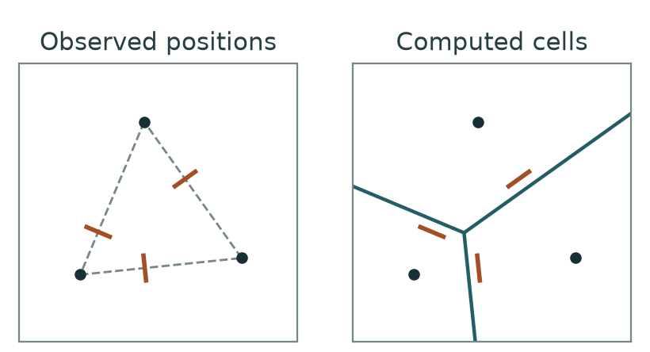

<div class="landing" markdown="1">
<div class="landing-hero" markdown="1">
<div class="landing-intro" markdown="1">

# Voronoi and power tessellations *in Python*

Compute 2D and 3D tessellations in bounded and periodic systems. Get cell geometry,
areas or volumes, and contacts between neighboring cells.

<div class="landing-links" markdown="1">

[Installation](#installation)
[API Reference](reference/index.md)

</div>

</div>
<figure class="landing-figure" markdown="1">
  
  <figcaption markdown="span">Four complete Voronoi cells from a fully periodic triclinic 3D calculation. [Run this example](guide/forward/index.md).</figcaption>
</figure>
</div>

<div class="landing-paths" markdown="1">
<section markdown="1">

## [Compute tessellations](guide/forward/index.md)

Voronoi cells assign space to the nearest point. Power (Laguerre) diagrams use
weights to shift the boundaries.

- **[2D](guide/planar.md)** — Bounded or periodic rectangles.
- **[3D](guide/domains.md)** — Bounded boxes and orthorhombic periodic cells; fully periodic triclinic cells.

[Identify which periodic copy of a neighbor shares a boundary](guide/periodic-contacts.md).

[Capabilities and limitations](guide/capabilities.md)

</section>
<section markdown="1">

## [Fit power weights](guide/inverse/index.md)

Keep the points fixed. For selected pairs, specify where their power separator
should cross the line joining them. Fit one set of power weights to all these
observations together.

<figure class="landing-cycle">
  
  <figcaption>
    <p>Ticks: observed positions. Solid interior lines: computed edges.</p>
    <p>These observations cannot all be matched exactly. All three cell pairs share an edge in this example.</p>
  </figcaption>
</figure>

[Fitting a separator does not guarantee a shared cell boundary](guide/inverse/index.md#from-a-fit-to-geometry).

</section>
</div>

<section class="landing-start" markdown="1">
<div markdown="1">

## Installation

```bash
python -m pip install pyvoro2
```

CPython 3.10–3.14 (GIL enabled). NumPy is the only required runtime dependency.

[Wheels and source builds](https://github.com/DeloneCommons/pyvoro2/blob/dev/CONTRIBUTING.md)

</div>
<div markdown="1">

## Divide a unit cube

Two points, two cells: each occupies half the cube.

```python
import pyvoro2 as pv

points = [[0.25, 0.5, 0.5],
          [0.75, 0.5, 0.5]]
box = pv.Box(((0.0, 1.0),) * 3)
result = pv.compute(points, domain=box)
print(result.cell_measures)
# [0.5 0.5]
```

</div>
</section>

<nav class="landing-explore" aria-labelledby="explore-the-documentation" markdown="1">

## Explore the documentation

- [Examples](examples/index.md)<br>
  Worked notebooks.
- [Theory](theory/index.md)<br>
  Definitions and fitting mathematics.
- [API Reference](reference/index.md)<br>
  Signatures, parameters, and return values.

</nav>

<div class="landing-footer" markdown="1">

Built on Voro++ tessellation engines, with Python interfaces, geometric analysis, and inverse fitting.

Beta · Project code: LGPLv3+ · Voro++: upstream license.

[Project](project/index.md) · [Development](development/index.md) · [License and attribution](project/license.md)

</div>
</div>
