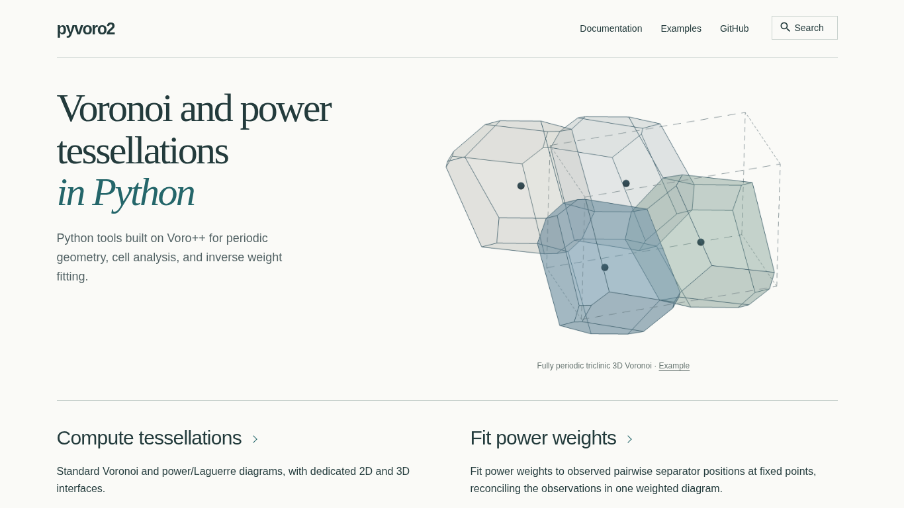
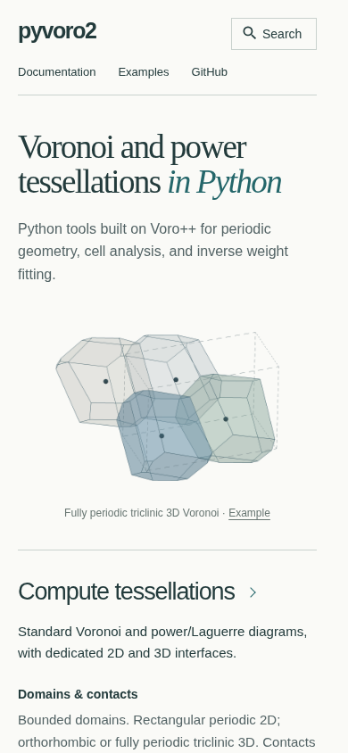
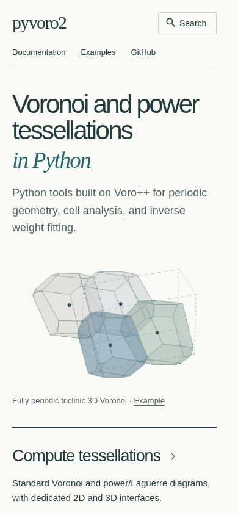

# DOC-W4-C1 — two landing-page directions

Review checkpoint for [#138](https://github.com/DeloneCommons/pyvoro2/issues/138)
and [#127](https://github.com/DeloneCommons/pyvoro2/issues/127). Neither direction
is accepted. This draft must remain unmerged until the maintainer chooses a
direction and requests finalization. C2 themes and C3 animation are deferred.

Base: live `dev` verified as `f5a65347ae3d4ae90fcf891dce4495030ed81f7c`.
Refinement started from the verified live PR #139 HEAD
`4160c5bd11e15398b3c2c2ba4d7e977569ee4cb5`, with a clean working tree.
This round changes only Home CSS and review evidence; the template, Markdown,
assets, navigation destinations and native search integration are unchanged.

## Compare the actual builds

All captures use Chromium, the native Zensical build, the same Markdown,
unchanged PNGs, and the same `/pyvoro2/` route on separate local servers.
The ordinary build temporarily shows A for review; this is not a design decision.

| A — Scientific editorial | B — Geometric showcase |
| --- | --- |
| [](screenshots/a-desktop-full.png) | [](screenshots/b-desktop-full.png) |
| [Full desktop](screenshots/a-desktop-full.png) | [Full desktop](screenshots/b-desktop-full.png) |
| [](screenshots/a-mobile-full.png) | [](screenshots/b-mobile-full.png) |
| [Full 390 px](screenshots/a-mobile-full.png) · [320 px](screenshots/a-narrow.png) · [Full 320 px](screenshots/a-narrow-full.png) | [Full 390 px](screenshots/b-mobile-full.png) · [320 px](screenshots/b-narrow.png) · [Full 320 px](screenshots/b-narrow-full.png) |

Desktop: **1366 × 768**. Mobile/narrow: **390/320 × 844**. Full-page versions
include both workflows, the inverse figure, Quick start, navigation and footer.

## Focused refinement round

Before captures are pinned to the last reviewed commit, not overwritten history.
Compare each hero at the same 1366 × 768 viewport:

| Direction | Before (`4160c5b`) | Refined |
| --- | --- | --- |
| A | [Previous hero](https://github.com/DeloneCommons/pyvoro2/blob/4160c5bd11e15398b3c2c2ba4d7e977569ee4cb5/review/w4-c1/screenshots/a-desktop.png) | [Current hero](screenshots/a-desktop.png) |
| B | [Previous hero](https://github.com/DeloneCommons/pyvoro2/blob/4160c5bd11e15398b3c2c2ba4d7e977569ee4cb5/review/w4-c1/screenshots/b-desktop.png) | [Current hero](screenshots/b-desktop.png) |

**A:** The introduction now aligns with the top of the composition, with 44 px
between the header rule and the hero box. The image grows from approximately
618 to 677 px wide at desktop (about 10%), keeping its complete 16:9 plate.
The headline now occupies three lines, with “in Python” on its own line at this
width. The caption is centered, smaller and muted, with no rule above it.
Both workflow entrances still appear in the first desktop viewport.

The [serif functional-heading experiment](refinement/a-serif-full.png) and
[retained sans-serif treatment](screenshots/a-desktop-full.png) are actual
Zensical renders with the same refined hero. Serif headings sustain the editorial
voice throughout, but make the capability titles feel like continuations of the
introduction. Sans-serif makes Compute, Fit and Quick start clearer practical
entry points, so this refinement retains sans-serif for those headings and serif
for the hero. At 320 px, slightly tighter heading spacing keeps the workflow
arrow with its title; no copy changes were needed.

**B:** The headline, distinct “in Python” line and introductory sentence now
share one left axis. The large centered plate follows this complete text block.
The image therefore starts lower than before: the first viewport contains less
of the plate, an explicit cost of restoring a coherent reading order while
preserving its scale. The full image remains uncropped in the page.

Compare the [1080 px width experiment](refinement/b-1080-full.png) with the
[retained 1120 px composition](screenshots/b-desktop-full.png). Both substantially
reduce the previous 1240 px spread. At 1120 px, the capability prose has slightly
more breathing room while the columns remain closely related; 1080 does not
provide a clear enough reading benefit to justify the extra compression. The
image retains its independent 960 px maximum in both tests. Sequential wide
capability rows and the larger inverse-fitting figure remain distinctive to B.

Both directions remove the lower Explore divider. Restrained whitespace now
connects Examples / Theory / API Reference with project and licensing metadata;
the rule above Explore remains. At 390 and 320 px both preserve source order,
complete scientific images, accessible search and a compact two-row header.
A has a shorter opening; B's larger introduction and geometry require more scroll.

## Design assessment

| Criterion | A — Scientific editorial | B — Geometric showcase |
| --- | --- | --- |
| Opening composition | Top-aligned serif identity beside a moderately larger scientific plate. | Left-aligned title, distinct second line and introduction above a large centered plate. |
| Geometry | Integrated with reading; centered, muted caption with no figure rule. | The geometry dominates; the larger plate makes periodic boundaries and complete cells easier to inspect. |
| Workflow rhythm | Compute and Fit are equal adjacent entrances, visible at the bottom of the first desktop screen. | Sequential horizontal rows pair each entrance with its detail or figure, giving the inverse figure more space. |
| Navigation | Compact wordmark and a quiet documentation route; native Search remains visible. | Serif wordmark, a narrower 1120 px header, the same destinations and native Search. |
| Mobile | More compact headline and a shorter opening; familiar reading rhythm. | Larger sans-serif headline and slightly wider hero; stronger identity, but more scrolling before workflows. |
| Cost | The hero has less visual impact than B; some readers may still see an editorial documentation page. | The first desktop screen does not expose the workflow entrances. The long hero and sequential rows delay Quick start. |

**Recommendation: develop A further.** It gives the geometry a clear identity
while making the two scientific workflows immediately discoverable. Its serif introduction and neutral functional headings fit the project's calm, precise tone. B is a credible alternative if
inspectable geometry should be the dominant first impression; its larger stage
would accommodate a future interactive hero particularly well. A could also
accommodate one inside its existing figure area. No viewer infrastructure has
been added. The choice remains with the maintainer.

Both concepts remove the blue Home-header mismatch while keeping the normal
blue header as the familiar documentation interface. The same project name,
search system, typography for body text, and destinations connect the two.

## Template and CSS architecture

The implementation follows the official [customization](https://zensical.org/docs/customization/)
and [front matter](https://zensical.org/docs/authoring/frontmatter/) interfaces.

- `theme.custom_dir: overrides` and `template: landing.html` select the inherited
  template for Home alone. `main.html` and `base.html` are not copied or replaced.
- The installed `zensical-ui` templates were read before choosing blocks.
  `main.html` extends `base.html`; `hero`, `content`, and `footer` are inside
  `data-md-component="container"`. The native header is outside it.
- The 25-line override adds navigation in `hero`, emits `page.content` in
  `content`, and omits the theme footer because the approved Markdown already
  contains the project/license footer. There is no duplicated scientific prose.
- The native instant-navigation implementation swaps the container and header
  topic, but does not replace the full header. Therefore Home keeps the native
  header/search mounted. CSS hides its ordinary navigation controls and presents
  its real search button alongside the Home navigation. A Home marker in the
  swapped container drives the styling through `:has()`; no persistent body
  class, DOM-patching script, or reload workaround is needed.
- The existing Home-only CSS was moved out of `extra.css` into `landing.css`.
  The documentation's three sticky-header rules are unchanged. Both alternatives
  share tokens and content; `extra.landing_direction: showcase` enables B only
  in a temporary review configuration. No duplicate public Home URLs are built.
- `build_previews.py` writes temporary configuration in the project root (a
  Zensical requirement), invokes the normal build twice, and copies each result
  to a fresh review directory. It does not compile Markdown or alter source.

The native header's DOM classes are an integration dependency. Re-run these
browser checks when upgrading Zensical/UI. This exploration was tested with
Zensical **0.1.2**, zensical-ui **0.0.42**, Python **3.12**, and Chromium
**155.0.8059.79**. CSS `:has()` requires a current browser. Firefox and Safari
were not tested. The cloud could not fetch Google Fonts; Home deliberately uses
system Arial/Georgia, and documentation comparisons used identical font
availability on baseline and candidates.

Home surface, text, caption, accent, rule and code colors use scoped tokens. C2 can map
these tokens to the native theme without changing content or layout. The current
light PNG presentation remains intentional; neither a theme toggle nor a dark
hero has been implemented. A benefits from retaining a quiet, continuous surface.
B's narrower container leaves useful side gutters for a possible restrained
scientific treatment in C2, after the composition is selected; no patterns have
been added. Both figure areas could accommodate later C3 work without changing
the approved reading order; no interactive infrastructure is included.

## Reproduce

Use the supported editable environment and documentation requirements:

```sh
python -m pip install -e '.[dev]' -r docs/requirements.txt
zensical build --clean --strict
python tools/landing/build_previews.py --output /tmp/pyvoro2-c1-review
```

The output must be fresh: existing variant destinations are rejected to prevent
stale pages/assets surviving a rebuild. Serve each variant in a separate terminal:

```sh
python -m http.server 8005 --directory /tmp/pyvoro2-c1-review/a
python -m http.server 8006 --directory /tmp/pyvoro2-c1-review/b
```

Open `http://localhost:8005/pyvoro2/` and
`http://localhost:8006/pyvoro2/`. For browser verification, build the unchanged
base separately and serve it on port 8003 under `/pyvoro2/`. Install Playwright
and `@axe-core/playwright` in a disposable review environment, outside the
repository's runtime and docs dependencies. Then:

```sh
CHROMIUM_PATH=/usr/bin/chromium node review/w4-c1/verify.cjs \
  http://localhost:8005/pyvoro2/ \
  http://localhost:8006/pyvoro2/ \
  http://localhost:8003/pyvoro2/
```

`NODE_PATH` may be needed to locate the disposable browser dependencies.
The script refreshes screenshots and `browser-results.json` in this directory.

## Validation evidence

See [browser results](browser-results.json) and
[static results](static-results.json). These are local checks, not GitHub CI.
The PR description records the observed CI state at handoff. All listed final
local checks passed. The browser run reports zero WCAG A/AA axe violations at
1366, 390 and 320 px in both variants, no page exceptions, and no page overflow.
Home/Guide/API transitions and Back/Forward retain a same-document sentinel;
native search returns and follows the periodic-contacts result. Mobile search
and drawer return, `#installation`, skip/focus navigation, and 200% root text
size also pass. Guide overview, forward guide, Theory and API Reference are
pixel-identical to baseline at both 1366 and 390 px (eight comparisons per
candidate). This is representative Chromium evidence, not a complete
screen-reader or cross-browser accessibility audit.

Local commands executed:

- `zensical build --clean --strict` — normal build and both preview builds.
- `python tools/export_notebooks.py --check`.
- `flake8 src tests tools benchmarks examples`.
- `pytest -q tests/integration/test_documentation_examples.py` — four tests.
- `git diff --check`.
- `node review/w4-c1/verify.cjs ...` — browser checks and captures.
- A Python standard-library HTML parser scanned all 93 HTML pages in each build
  for internal link, asset and fragment resolution. No missing targets.
- Source comparison confirms `docs/index.md` is byte-identical to reviewed
  `4160c5b` (and differs from the original `dev` only by `template:`), and
  both scientific PNGs retain their baseline SHA-256 hashes. Non-Home HTML is
  identical to the baseline after removing the added stylesheet link.

The first refinement browser run passed both Home variants but could not finish
the documentation pixel comparison because the older local baseline server no
longer responded. It was restarted and the full suite rerun. A focused code
review found no severity findings. These are local results, separate from CI.
The review script retains its wait for the theme's existing 125 ms delayed drawer
close; no site JavaScript or workaround was introduced.

No package code, API, README, notebook sources, navigation inventory,
Markdown extensions, MathJax integration, dependencies, or deployment workflows
were changed. GitHub Pages remains main-only. This work does not authorize
merging, design acceptance, C2, or C3.
