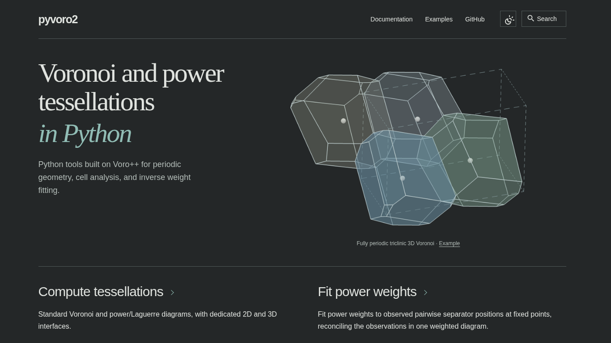

# DOC-W4-C2: production light and Carbon

Carbon / Graphite editorial is the maintainer-selected dark theme. This is the
final implementation for review in [draft PR #141](https://github.com/DeloneCommons/pyvoro2/pull/141),
targeting `dev`, under [issue #140](https://github.com/DeloneCommons/pyvoro2/issues/140).
Phase 2 began after verifying PR HEAD `5c41b8593a3338e3798c2731976e53d2bde8f18f`.
The [earlier comparison and scientific prototypes](https://github.com/DeloneCommons/pyvoro2/tree/5c41b8593a3338e3798c2731976e53d2bde8f18f/review/w4-c2)
remain in history. Midnight is no longer in the production tree.

## Production browser captures

These are native Zensical builds of the normal configuration, captured in
Chromium 155.0.8059.79. Desktop is 1366 × 768; mobiles are 390 × 844 and
320 × 844. Click the Home images for full-page versions.

| Light | Carbon |
| --- | --- |
| [](screenshots/light-desktop-full.png) | [](screenshots/carbon-desktop-full.png) |
| [390 px full](screenshots/light-mobile-full.png) · [320 px full](screenshots/light-narrow-full.png) | [390 px full](screenshots/carbon-mobile-full.png) · [320 px full](screenshots/carbon-narrow-full.png) |

| Surface | Light | Carbon |
| --- | --- | --- |
| Guide | [Desktop](screenshots/light-guide.png) · [390](screenshots/light-guide-390.png) · [320](screenshots/light-guide-320.png) | [Desktop](screenshots/carbon-guide.png) · [390](screenshots/carbon-guide-390.png) · [320](screenshots/carbon-guide-320.png) |
| API | [Desktop](screenshots/light-api.png) · [Table](screenshots/light-api-table.png) · [390](screenshots/light-api-390.png) · [320](screenshots/light-api-320.png) | [Desktop](screenshots/carbon-api.png) · [Table](screenshots/carbon-api-table.png) · [390](screenshots/carbon-api-390.png) · [320](screenshots/carbon-api-320.png) |
| Theory | [Desktop](screenshots/light-theory.png) · [390](screenshots/light-theory-390.png) · [320](screenshots/light-theory-320.png) | [Desktop](screenshots/carbon-theory.png) · [390](screenshots/carbon-theory-390.png) · [320](screenshots/carbon-theory-320.png) |
| Search | [Light](screenshots/light-search.png) | [Carbon](screenshots/carbon-search.png) |
| Mobile navigation | [Light](screenshots/light-drawer.png) · [200%, 320](screenshots/light-drawer-text-200.png) | [Carbon](screenshots/carbon-drawer.png) · [200%, 320](screenshots/carbon-drawer-text-200.png) |
| Palette keyboard focus | [Light](screenshots/light-keyboard.png) | [Carbon](screenshots/carbon-keyboard.png) |
| Home at 200% text | [1366](screenshots/light-text-200-1366.png) · [390](screenshots/light-text-200-390.png) · [320](screenshots/light-text-200-320.png) | [1366](screenshots/carbon-text-200-1366.png) · [390](screenshots/carbon-text-200-390.png) · [320](screenshots/carbon-text-200-320.png) |
| Articles at 200% text, 390 px | [Guide](screenshots/light-guide-text-200.png) · [API](screenshots/light-reference-text-200.png) · [Theory](screenshots/light-theory-text-200.png) | [Guide](screenshots/carbon-guide-text-200.png) · [API](screenshots/carbon-reference-text-200.png) · [Theory](screenshots/carbon-theory-text-200.png) |

## Changes since C2-1

- Carbon variables now live in `themes.css`; candidate CSS and the dual-build
  helper are removed. Native Auto / Light / Dark and persistence remain native.
- Home consumes dark tokens with its approved light colors as fallbacks. This
  removes duplicated Home mappings. The small pre-initialization OS fallback
  remains CSS-only, with static parity checks against the slate declarations.
- Production B2 edges and lattice are clearer at mobile sizes. Four complete
  cells retain exact computed geometry, periodic image identities and camera.
  The background matches Carbon; no white plate, inversion, clipping or glow.
- Production inverse colors separate the computed tessellation from observation
  marks. Three sites, observations, weights, polygons and assertions are intact.
- Explore-to-first-metadata spacing is 16 px instead of 24 px at all three
  widths. Other footer paragraph spacing and all copy remain unchanged.
- A container rule removes spare native header title margins only when enlarged
  controls would otherwise overflow a very narrow documentation viewport. Native
  drawer and nested-panel widths are capped at the viewport at enlarged text.

The light hero, workflow sections, Quick start and Explore link text are
pixel-identical to C1 at 1366/390/320 px. Both approved light PNGs are byte-identical.
The Carbon figures have stronger small edges without competing with text; lattice
lines remain secondary. The dark inverse boundaries and warm observation marks
remain distinct. Long API pages use the same quiet palette and readable syntax.

## Verification

Exact browser assertions and raw axe findings are in [verify.cjs](verify.cjs),
[browser-results.json](browser-results.json), [verify_edges.cjs](verify_edges.cjs)
and [edge-results.json](edge-results.json). No axe rules or offending nodes are
excluded; the main browser command exits **1** if any accessibility finding remains.
Functional assertions are reported separately from accessibility failures.

Commands run from the repository root:

```bash
zensical build --clean --strict
flake8 src tests tools benchmarks examples
python tools/export_notebooks.py --check
pytest -q tests/integration/test_documentation_examples.py \
  tests/inverse/separator/test_fit.py tests/inverse/separator/test_realization.py \
  tests/forward/planar/test_edge_properties.py
python tools/render_landing.py --check-only
python tools/landing/render_separator_cycle.py --check-only
MPLCONFIGDIR=work/mpl XDG_CACHE_HOME=work/cache \
  python tools/landing/verify_assets.py --records work/reproduced
python review/w4-c2/check_static.py WORK/production/pyvoro2 WORK/baseline/pyvoro2
git diff --check
```

Use a disposable Node environment with Playwright 1.62.1, `@axe-core/playwright`
and axe-core 4.14.1, setting `NODE_PATH` and `CHROMIUM_PATH` as appropriate:

```bash
node review/w4-c2/verify.cjs PRODUCTION_URL BASELINE_C1_URL
node review/w4-c2/verify_edges.cjs PRODUCTION_URL
```

Build each served directory with `python tools/landing/build_preview.py --output DIR`
(the helper runs the exact strict command). Serve its parent so the URL ends in
`/pyvoro2/`. The C1 baseline is commit `a9d5f3d`, built with the same docs stack.
The rendering dependencies are optional and offline; neither the normal build
nor runtime requirements changed. [Reproduction and provenance](../../tools/landing/README.md)
include exact colors, widths, camera, renderer, hashes and scientific checks.

Results:

- Strict native build: pass, no issues. Flake8, notebook export check and
  `git diff --check`: pass. Focused scientific suite: **30 passed, 0 skipped**.
- Offline B2 checks: four complete cells, volume sum 3.0, 56 oriented faces,
  51 drawn polygons. Maximum bisector residual 3.28e-16, reciprocal vertex
  residual 7.45e-16, independent volume error 4.44e-16. Camera unchanged.
- Offline inverse checks: optimal fit; unit area; all three realized contacts;
  reconstructed polygon areas agree. Raw cells from both original C2-1
  generators exactly match the final production geometry hashes.
- Eight independent renders: all four assets byte-identical to committed PNGs;
  light/dark raw geometry identical; source and geometry hashes match provenance.
- Local link/anchor/asset check: **93 HTML pages**, no failures;
  **91 ordinary article bodies unchanged**. No numerical code, API, notebook,
  README, navigation hierarchy, normal dependencies or deployment changes.
- Browser functional checks: initial Auto for both OS preferences; manual
  overrides and reload; returning to Auto and following live OS changes;
  Home → Guide → API → Home, Back/Forward with instant-navigation sentinel;
  native search-result navigation; mobile drawer; keyboard palette and focus.
- Both figures: exactly one visible and accessible image per figure, meaningful
  alt/caption, preserved aspect ratio and stable figure boxes during theme changes.
  Six delayed-bootstrap checks cover Home/Guide under both OS preferences and
  saved opposite-OS overrides. Native bundle delayed 1500 ms: correct first paint
  and Home figures before initialization. Normal frame samples show no wrong palette.
- Text reflow: 24 Home cases (three widths × four text sizes × two themes), plus
  18 Guide/API/Theory cases at 200%. No page overflow. Mobile Search opens and
  drawer stays inside the viewport and navigates Home at 200% in both themes.
- Axe WCAG A/AA: **32 scans; 29 clear, 3 with findings**. These are the two
  underlying native issues below, not a zero-violation result.

| Measured contrast | Light | Carbon |
| --- | ---: | ---: |
| Home text | 11.40:1 | 11.62:1 |
| Muted Home text | 6.01:1 | 7.82:1 |
| Home links | 6.31:1 | 7.27:1 |
| Lowest documentation syntax token | 4.52:1 | 8.20:1 |

[Color measurements](contrast-results.json) record the production computed tokens.
Scientific image colors are illustrative, with the original geometry and
observations supplied by the numerical computation, not inferred from pixels.

## Known native accessibility limitations — maintainer acceptance required

1. **Light Search breadcrumb contrast:** `color-contrast`, 12 nodes, **3.33:1**
   against **4.5:1**. Zensical **0.1.2**, `zensical-ui` **0.0.42**, bundle
   `bundle.3cb411a8.min.js`. Native shadow-root breadcrumbs use
   `color: rgb(var(--color-foreground) / .45)`. The inherited light foreground
   is already `0 0 0`; changing a foreground token cannot make it darker.
   The documented Search configuration supports `enabled` and `separator`,
   not breadcrumb styling. There is no exposed part or documented token for
   this opacity. Upstream needs an accessible default (roughly .54 opacity or
   greater against white), or a supported token/part. No mutation script,
   theme fork, generated-selector override or axe suppression was introduced.
2. **API table keyboard access at 320 px:** `scrollable-region-focusable`, one
   native `.md-typeset__scrollwrap` in `reference/api/` per theme, 305 px wide
   with 347 px scroll content. The same finding reproduces on unchanged C1.
   Current Chromium permits programmatic focus, but axe explicitly checks
   Safari keyboard accessibility. The native wrapper needs appropriate focus
   semantics, such as `tabindex="0"` when scrollable and visible focus styling.
   The generated table and article content were not rewritten to hide the finding.

[Native diagnosis](native-findings.json) and the exact targets/failure summaries
in [browser-results.json](browser-results.json) retain both issues. The main
browser test deliberately exits **1** for these three failing scans; the cold
paint/reflow test exits **0**. This does not block reporting the functional
passes, and does not establish full WCAG conformance.

Limits: browser testing used Chromium on Linux, not a physical mobile device,
Safari/Firefox, or a human screen-reader session. Role-based accessibility checks
verify hidden figure exclusion; they are not a complete assistive-technology
certification. The harness ignores CDN certificate errors so configured MathJax
loads and Theory equations render. Google Fonts and GitHub metadata requests
remain blocked by the environment tunnel; both baseline and production captures
use the same font fallbacks. No website network/security settings changed.
Raster reproducibility is proven on the recorded Mesa/llvmpipe
stack; another graphics driver may produce different raster bytes. No local
checks were skipped. Final PR-head CI status is linked in the PR description.

The selected implementation is ready for final maintainer inspection, with the
two native accessibility limitations explicitly left for acceptance. The PR
remains draft; neither PR #141 nor issue #140 is merged/closed by this work.
