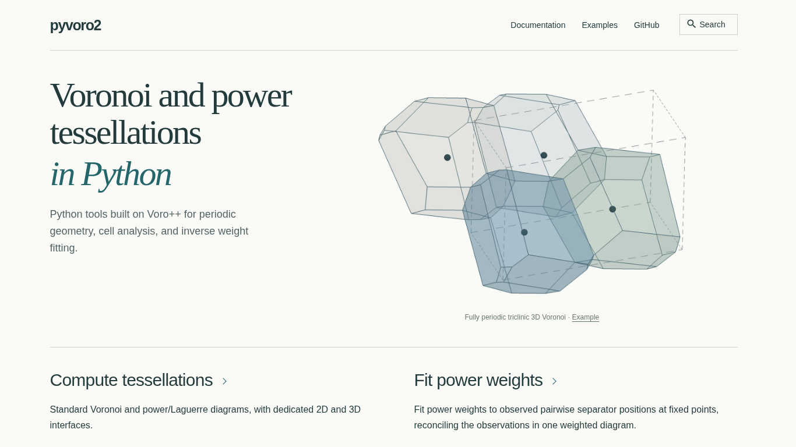
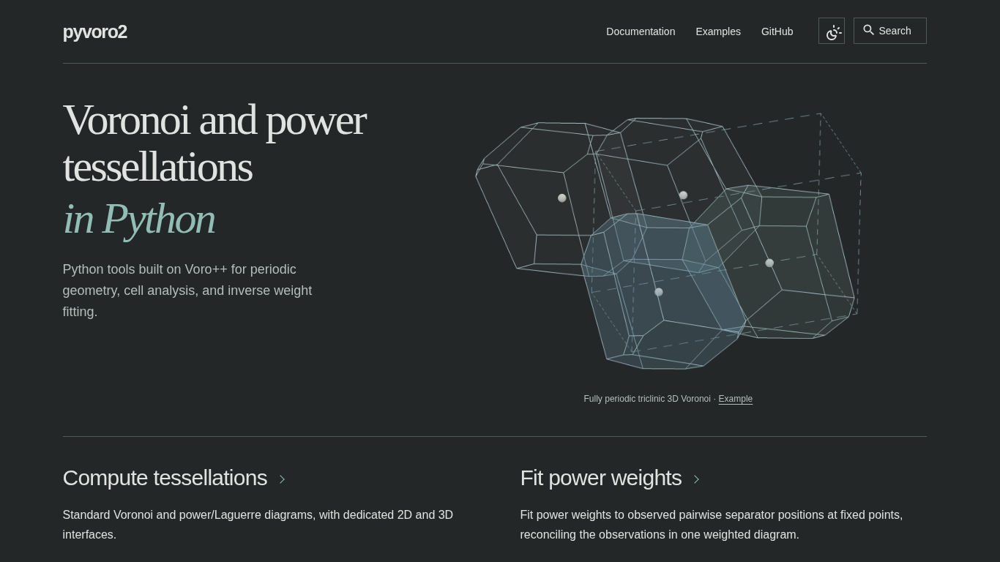
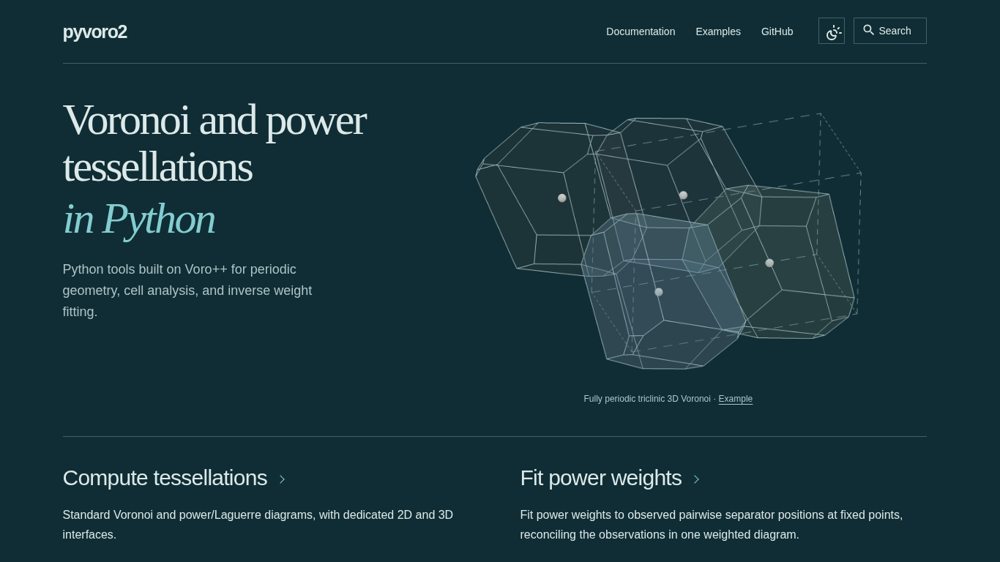

# C2-1: native themes and two dark directions

**Exploratory review checkpoint; neither palette is selected.**
[Issue #140](https://github.com/DeloneCommons/pyvoro2/issues/140), under
[documentation refresh #127](https://github.com/DeloneCommons/pyvoro2/issues/127).
Base `dev`: `a9d5f3d1f020033db083900348b2816b154d80c4`, the merged C1 homepage.
New branch: `docs/doc-w4-c2-native-theme-exploration`; draft PR targets `dev`.
The supplied checkout initially pointed to `db0884c`; an explicit fetch of the
`dev` ref verified the requested baseline before the branch was created.

## Compare the actual built site

All captures are Chromium rendering Zensical output, with identical content,
layout, camera and geometry. Desktop is 1366 × 768; mobile is 390 × 844 and
320 × 844. Full-page captures include both workflows, Quick start and footer.

| Approved light baseline | A: Graphite editorial | B: Midnight teal |
| --- | --- | --- |
| [](screenshots/baseline-1366-full.png) | [](screenshots/graphite-desktop-full.png) | [](screenshots/midnight-desktop-full.png) |
| [390 px](screenshots/baseline-390-full.png) · [320 px](screenshots/baseline-320-full.png) | [390 px](screenshots/graphite-mobile-full.png) · [320 px](screenshots/graphite-narrow-full.png) | [390 px](screenshots/midnight-mobile-full.png) · [320 px](screenshots/midnight-narrow-full.png) |

| Surface | Current light with native toggle | A: Graphite | B: Midnight |
| --- | --- | --- | --- |
| Home desktop | [Viewport](screenshots/light-desktop.png) · [Full](screenshots/light-desktop-full.png) | [Viewport](screenshots/graphite-desktop.png) · [Full](screenshots/graphite-desktop-full.png) | [Viewport](screenshots/midnight-desktop.png) · [Full](screenshots/midnight-desktop-full.png) |
| Home 390 px | [Viewport](screenshots/light-mobile.png) · [Full](screenshots/light-mobile-full.png) | [Viewport](screenshots/graphite-mobile.png) · [Full](screenshots/graphite-mobile-full.png) | [Viewport](screenshots/midnight-mobile.png) · [Full](screenshots/midnight-mobile-full.png) |
| Home 320 px | [Viewport](screenshots/light-narrow.png) · [Full](screenshots/light-narrow-full.png) | [Viewport](screenshots/graphite-narrow.png) · [Full](screenshots/graphite-narrow-full.png) | [Viewport](screenshots/midnight-narrow.png) · [Full](screenshots/midnight-narrow-full.png) |
| User Guide: forward quickstart | [Light](screenshots/light-guide.png) | [A](screenshots/graphite-guide.png) | [B](screenshots/midnight-guide.png) |
| API Reference: signatures | [Light](screenshots/light-api.png) | [A](screenshots/graphite-api.png) | [B](screenshots/midnight-api.png) |
| API Reference: table | [Light](screenshots/light-api-table.png) | [A](screenshots/graphite-api-table.png) | [B](screenshots/midnight-api-table.png) |
| Theory: power diagrams | [Light](screenshots/light-theory.png) | [A](screenshots/graphite-theory.png) | [B](screenshots/midnight-theory.png) |
| Examples | [Light](screenshots/light-examples.png) | [A](screenshots/graphite-examples.png) | [B](screenshots/midnight-examples.png) |
| Native search results | [Light](screenshots/light-search.png) | [A](screenshots/graphite-search.png) | [B](screenshots/midnight-search.png) |
| Native mobile drawer | [Light](screenshots/light-drawer.png) | [A](screenshots/graphite-drawer.png) | [B](screenshots/midnight-drawer.png) |
| Existing architecture admonition | [Light](screenshots/light-admonition.png) | [A](screenshots/graphite-admonition.png) | [B](screenshots/midnight-admonition.png) |
| Keyboard palette focus | [Light](screenshots/light-keyboard.png) | [A](screenshots/graphite-keyboard.png) | [B](screenshots/midnight-keyboard.png) |
| 200% text, 320 px | — | [A](screenshots/graphite-text-200-320.png) | [B](screenshots/midnight-text-200-320.png) |

The representative Guide currently has no admonitions. An existing Development
page supplies the separate admonition check; no article content was added.

## Assessment and recommendation

**Recommend A, Graphite editorial, for maintainer consideration.** Its neutral
charcoal gives long API pages and syntax colors a quieter setting. It preserves
the editorial character of the light Home without making every documentation
page strongly colored. The tradeoff is less distinctive teal identity and a
subdued hero; small edges still need attention in the final scientific render.

B, Midnight teal, ties the interface more directly to the blue-green geometry.
Its brighter cyan accent is clear and consistent across Home, links and code.
The saturated background is more noticeable during long reading, and the blue
cell loses some separation from its surroundings. It is a viable alternative,
not rejected by the checks.

Both keep the serif headline, existing sans-serif body, line lengths and section
spacing. Code uses differentiated, softened syntax colors; prose links in normal
docs gain underlines so meaning does not depend on color. The normal header uses
muted teal in light mode and related dark surfaces in each candidate. Search
retains Zensical's native neutral dialog and interactions.

| Measured color pair | Light | Graphite | Midnight |
| --- | ---: | ---: | ---: |
| Main Home text / page | 11.40:1 | 11.62:1 | 11.64:1 |
| Muted text / page | 6.01:1 | 7.82:1 | 7.93:1 |
| Accent / page | 6.31:1 | 7.27:1 | 8.01:1 |
| Minimum configured dark code token / code surface | — | 8.20:1 | 8.20:1 |

[Contrast calculations](contrast-results.json). These token measurements do not
certify every pixel or scientific line in an illustration.

## Native integration and light preservation

The installed Zensical 0.1.2 / zensical-ui 0.0.42 templates were inspected:
`partials/header.html`, `partials/palette.html` and
`partials/javascripts/palette.html`. The palette is a native
`form[data-md-component="palette"]`, with native radio inputs and cycling labels.
Home's existing header selector now retains this form alongside native Search.
There is no duplicated control, custom persistence, router or site JavaScript.
The existing `landing.html` still extends `main.html` and renders `page.content`.

The configuration follows the documented Auto → Light → Dark cycle, with
`default` and `slate` schemes. Candidate choice is build-time CSS only: the helper
substitutes the graphite/midnight token sheet and invokes strict native builds.
The ordinary config loads A provisionally so the branch can be previewed; that
is **not maintainer selection**.

A first visit otherwise paints the default light scheme until the native bundle
runs. A CSS-only `prefers-color-scheme` fallback now applies while the native
`data-md-color-media` attribute is absent. It stops matching when native state
arrives, and does not override a persisted manual Light selection. Its provisional
color declarations mirror the slate rules; keep both in sync during exploration.
The palette files define inert shared tokens in both schemes for that fallback.

Home controls flow together instead of relying on a fixed search-width offset.
At enlarged text, container queries move the controls to a row before the existing
links. Normal-size Home content below the header is **pixel-identical** to C1 at
1366, 390 and 320 px. Only the header accommodates the added control. No footer
spacing correction, copy change, new navigation or homepage section was included.

Official interfaces:
[palette and system preference](https://zensical.org/docs/setup/colors/),
[light/dark images](https://zensical.org/docs/authoring/images/#light-and-dark-mode),
[template customization](https://zensical.org/docs/customization/).

## Scientific assets: preliminary only

The comparison uses two **provisional transparent dark PNGs** in
`docs/assets/landing/exploration/`, shared by both candidates. There are no white
plates or CSS inversion in the final comparison captures. The B2 generator keeps
all four computed cells, IDs, vertices/faces, contact shifts, lattice, camera,
opacity, lighting and scale; only face/edge/site/frame colors and background
transparency change. The inverse generator retains sites, observations, fit,
computed polygons, contacts, line positions and assertions, changing colors only.

The existing B2 checks pass (56 oriented faces, 51 displayed polygons, volume
sum 3, reciprocal vertices/bisectors and independent volume reconstruction).
The inverse optimal-fit, nonzero residual, area and three-contact assertions pass.
Both light generators reproduce the committed approved PNGs **byte for byte**.
Only one image per figure is exposed to the accessibility tree: native
`#only-light` / `#only-dark` works on the explicit HTML images. Dimensions,
alt text, captions and aspect ratios are retained.

These are computed-geometry prototypes, **not final production image acceptance**.
At 320 px the B2's fine edges and dashed frame remain faint. Final opacity/edge
balance, palette-specific scene tuning, repeatability/provenance finalization and
cleanup belong to phase 2 after selection. The unchanged light render record in
`tools/landing/provenance.json` remains a historical record of its original source;
it was not rewritten as if these prototypes were approved production assets.

[Preliminary B2 render record](hero-prototype.json) ·
[Figure checks and hashes](figure-results.json).
Offline PyVista/VTK dependencies are absent from normal docs/runtime/CI requirements.
Both generators reject a dark output path resolving to the approved light PNG.

## Verification results and limits

- `zensical build --clean --strict`: passed, no issues. Both candidate builds also
  passed with the same strict flags.
- `flake8 src tests tools benchmarks examples`: passed.
- `python tools/export_notebooks.py --check`: passed.
- Focused tests below: **30 passed**.
- Internal links/assets/fragments: **93 HTML pages passed**; **91 non-Home article
  bodies are unchanged** against the native baseline build.
- Native Auto with fresh light/dark OS preferences; manual overrides; reload;
  live OS changes in Auto; Home → Guide → API → Home; Back/Forward; deep links;
  native search and result navigation; mobile drawer; keyboard palette controls:
  passed. Instant-navigation sentinel retained throughout the route/history test.
- Home images: exactly one accessible, correctly selected image per figure,
  loaded with preserved aspect ratio at all three widths.
- Cold-load regression: both OS preferences, Home and deep Guide, both candidates,
  with native bundle delayed **1500 ms**; correct page colors at first contentful
  paint and correct Home figures before native initialization. Persisted Light
  also survives a delayed reload under a dark OS.
- Header reflow: **24 combinations**, both candidates × 1366/390/320 ×
  100/125/150/200% root text; no horizontal overflow, intersecting brand/control/link
  boxes, or failed control hit tests. Normal captures use reduced-motion preference.
- **Axe WCAG A/AA: 29 of 30 scans have zero violations.** The light native Search
  result view reports one `color-contrast` rule violation affecting 12 breadcrumb
  elements, measured **3.33:1** (required 4.5:1). The installed search component's
  shadow DOM uses `.n { color: rgb(var(--color-foreground)/.45) }` without an exposed
  CSS part. The result remains recorded in full, not excluded from axe. The review
  script permits only that exact known class of search finding; other findings
  fail. No replacement search, injected shadow-DOM styling or dependency patch was
  introduced. Dark search scans have zero axe violations.
- An independent review found cold-paint and enlarged-text overlap defects;
  targeted regressions now pass after fixes. The relative-path image overwrite
  guard and preview helper's isolated output paths were also corrected.

[Browser results](browser-results.json) · [Cold-load/reflow results](edge-results.json) ·
[Static results](static-results.json).

Tested with Python 3.12.14, Zensical 0.1.2, zensical-ui 0.0.42, Chromium
155.0.8059.79, Playwright 1.62.1 and axe-core 4.14.1. Offline render versions are
recorded in `hero-prototype.json` (PyVista 0.46.4, VTK 9.5.2, NumPy 2.5.5,
Matplotlib 3.11.2, Pillow 13.0.0). Google Fonts were unavailable; both comparison
builds used identical font availability, and Home uses system fonts.
Firefox/Safari, real-device browser zoom and a full screen-reader audit were not
run. Text resizing and 320px reflow are covered; this is not full phase-2 acceptance.
Remote GitHub CI status must be checked separately from these local results.

## Reproduce

Use a Python 3.11+ docs environment and a C++17 compiler. On this machine the
inherited `CXX=clang++` referred to a missing binary; `CC=gcc CXX=g++` worked.
No dependency declarations were changed.

```bash
CC=gcc CXX=g++ python -m pip install -e '.[all]' -r docs/requirements.txt
python tools/landing/build_theme_previews.py --output work/c2-previews

# Run each in its own terminal; both must be served at /pyvoro2/.
python -m http.server 8771 --directory work/c2-previews/graphite
python -m http.server 8772 --directory work/c2-previews/midnight
```

Build an untouched native comparison, with the same docs dependencies:

```bash
mkdir -p work/c1-source
git archive a9d5f3d1f020033db083900348b2816b154d80c4 | tar -x -C work/c1-source
(cd work/c1-source && python tools/landing/build_preview.py --output ../c1-preview)
python -m http.server 8766 --directory work/c1-preview
```

Review-only browser dependencies (not site dependencies):

```bash
npm install --prefix work/browser playwright @axe-core/playwright
NODE_PATH="$PWD/work/browser/node_modules" CHROMIUM_PATH=/usr/bin/chromium \
  node review/w4-c2/verify.cjs \
  http://127.0.0.1:8771/pyvoro2/ http://127.0.0.1:8772/pyvoro2/ \
  http://127.0.0.1:8766/pyvoro2/
NODE_PATH="$PWD/work/browser/node_modules" CHROMIUM_PATH=/usr/bin/chromium \
  node review/w4-c2/verify_edges.cjs \
  http://127.0.0.1:8771/pyvoro2/ http://127.0.0.1:8772/pyvoro2/
python review/w4-c2/check_static.py work/c2-previews/graphite/pyvoro2 work/c1-preview/pyvoro2
```

Focused checks:

```bash
zensical build --clean --strict
flake8 src tests tools benchmarks examples
python tools/export_notebooks.py --check
pytest -q tests/integration/test_documentation_examples.py \
  tests/inverse/separator/test_fit.py tests/inverse/separator/test_realization.py \
  tests/forward/planar/test_edge_properties.py
```

For the provisional figures, use a separate offline rendering environment with
PyVista 0.46.4 / VTK 9.5.2 and the versions recorded above:

```bash
VTK_DEFAULT_OPENGL_WINDOW=vtkEGLRenderWindow python tools/render_landing.py \
  --dark-prototype --output docs/assets/landing/exploration/triclinic-voronoi-dark.png
python tools/landing/render_separator_cycle.py --dark-prototype \
  --output docs/assets/landing/exploration/separator-cycle-dark.png
python tools/render_landing.py --check-only
```

**Stop here:** maintainer selects A or B before production image pairs, theme
cleanup, footer polish and final acceptance. Keep the PR draft; do not merge,
close #140, change numerical APIs or alter main-only Pages deployment.
