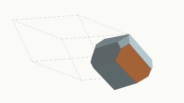
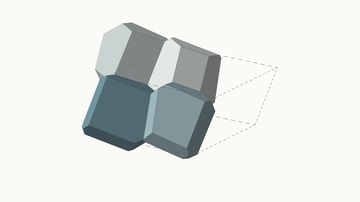
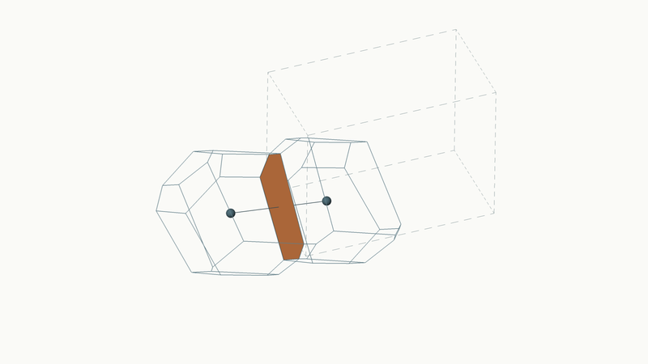
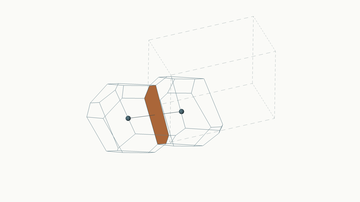
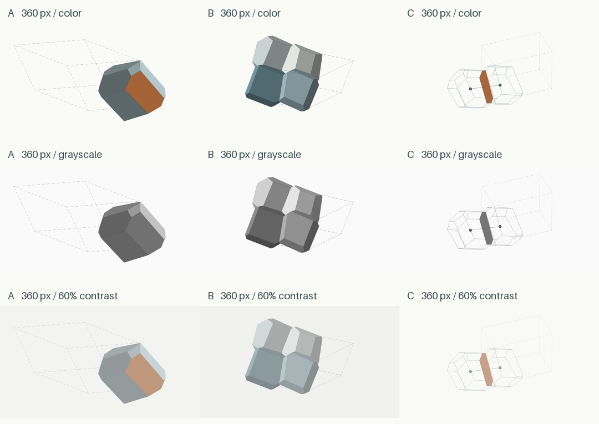

# DOC-W4-A: three scientific illustration candidates

**Current review: [round two — refined translucent B/C comparison](ROUND-2.md).**
The first-round candidates and recommendation below are retained as exploration
history; no direction has been selected or discarded.

**Exploration only — awaiting maintainer selection.** Related:
[#134](https://github.com/DeloneCommons/pyvoro2/issues/134),
[#127](https://github.com/DeloneCommons/pyvoro2/issues/127).
No final asset is selected. These temporary previews stay outside published
`docs/`; remove unselected candidates before the final W4-A merge. Landing-page
integration belongs to [#135](https://github.com/DeloneCommons/pyvoro2/issues/135).

All three use the **same four-site standard Voronoi computation** from the
[forward quickstart](../../docs/guide/forward/index.md), not invented meshes.
Sources are 1600 × 900 PNGs on a plain warm-white background. The previews below
are actual 800 × 450 exports; click a preview for its full-resolution source.
There was no existing W4-A hero asset to replace. The landing page is unchanged.

## A — Cell portrait (recommended direction, not selected)

[](candidates/a-cell.png)

One complete cell, external ID **40**, carries the composition; the lattice
extends into open space to its left. The wide, low camera makes the polyhedron
large enough to read as a faceted object at homepage scale, with one copper
interface as the focal point. Its weakness is explanatory: the neighbor is
intentionally not drawn, and the lattice can read as a second object without a
caption. This is the strongest starting point for a restrained hero, while C
is better at teaching the contact relationship.

**Caption proposal:** Complete Voronoi cell 40 in a fully periodic triclinic
lattice. The copper face meets image `10 + (-1, 0, 0)`; the dashed outline marks
the fundamental parallelepiped, not a clipping boundary.

**Alt-text proposal:** A complete faceted Voronoi cell, ID 40, next to a dashed
skew lattice outline. Its copper face meets the image of site 10 translated by
minus the first lattice vector. The neighbor cell is not shown.

**Mobile, 360 × 202:**



## B — Four-cell assembly

[](candidates/b-lattice.png)

All four returned cells appear as a compact opaque assembly with muted tonal
differences. This gives the most immediate sense of a tessellation and the
strongest mass at small size, without overlapping transparent surfaces. It
also hides much of the lattice and internal interfaces; at 360 px the broad
facets can look block-like, and the viewer cannot infer image-qualified
adjacency. There is **no highlighted periodic contact in B**: its purpose is
the multi-cell composition, not the interface demonstration.

**Caption proposal:** Four complete Voronoi cells from the deterministic
triclinic example, retaining external IDs 40, 10, 70, and 20. Dashed lines show
the lattice parallelepiped; periodic cells can extend beyond it.

**Alt-text proposal:** Four interlocking, opaque blue-gray Voronoi polyhedra
extend beyond a dashed skew lattice outline. Their geometry comes from four
sites in a fully periodic triclinic computation.

**Mobile, 360 × 202:**



## C — Image-qualified interface

[](candidates/c-contact.png)

The two complete wireframes expose the actual shared polygon between cell 40
and the translated cell 10, with their sites joined by a straight segment.
This is the clearest explanation of an image-qualified contact and is easy to
relate to the returned face records. It is also the busiest option: rear edges
overlap, and the faint lattice loses emphasis at mobile size or reduced
contrast. The shared face remains distinct in grayscale because it is the
only filled polygon, not merely because it is copper.

**Caption proposal:** Contact `(40, 10, (-1, 0, 0))`: cell 40 shares the filled
face with the image of cell 10 translated by `-a = (-2, 0, 0)`. Solid lines are
cell edges and the site connector; dashed lines are the lattice outline.

**Alt-text proposal:** Two complete wireframe Voronoi cells meet at a filled
six-sided face. Their site markers lie on opposite sides of this face. One
cell is external ID 40; the other is ID 10 translated by minus the first
triclinic lattice vector. A dashed lattice outline gives periodic context.

**Mobile, 360 × 202:**



## Visual review and decision still needed

Inspected each actual 800 px and 360 px export, including crop, line weight,
spacing, flat shading, and plain-background behavior. A small camera study
led to A's wider composition; none of those intermediate renders is published.
No embedded small labels are needed to read the primary shapes. Captions and
alt text must carry external IDs and shift semantics during W4-B integration.

[](candidates/small-scale-review.png)

Open the sheet at native size: each tile is exactly 360 px wide. Grayscale and
60% contrast are useful stress tests, **not** a full color-vision simulation or
an accessibility certification. B's cell identities must not be inferred from
color; C's fill-versus-wire distinction survives grayscale best. The faint
lattice is a remaining small-scale weakness, especially in C. The source PNGs
use an opaque `#fafaf7` background; dark-theme integration has not been tested.

**Recommendation:** refine A if the priority is a memorable first impression;
choose C if explicitly explaining image-qualified contacts is more important.
The maintainer should select the direction before any final polishing,
discarding alternatives, or landing-page work. This draft does not satisfy the
issue's later final-selection/production-acceptance gates.

The secondary inverse-fitting diagram is deferred in this iteration so that
review stays focused on the main 3D illustration. No inverse geometry was
generated or validated here.

## Scientific provenance

- Verified live `dev` HEAD before implementation:
  `9788f4e487e04b660c290a94daa83de9b5c1e16f` (DOC-W3).
- Public API only: `pyvoro2.PeriodicCell`, `pyvoro2.compute`, result fields.
  Package version `0.9.0.dev0`; library source is unchanged from that revision.
- Lattice rows: `(2,0,0)`, `(0.5,1.5,0)`, `(0.25,0.375,1)`.
  Fractional sites: `(0.15,0.20,0.30)`, `(0.65,0.25,0.35)`,
  `(0.35,0.75,0.70)`, `(0.80,0.70,0.85)`, multiplied by the lattice matrix.
  External IDs in input order: `[40,10,70,20]`. No randomness or seed.
- Cells are indexed by their external `id`, never by raw result-list order.
  Returned `site` and `vertices` stay in the same coordinate system. In
  particular, returned site **20** is `(0.1625,1.36875,0.85)`, one first-vector
  translation from input `(2.1625,1.36875,0.85)`; it is **not** independently
  rewrapped to make the assembly look more like the parallelepiped.
- A and C use the returned face `(40,10,(-1,0,0))`, with reciprocal
  `(10,40,(1,0,0))`. C translates **both** site and all vertices of cell 10 by
  `(-1,0,0) @ vectors = (-2,0,0)`. No cell is shrunk, exploded, clipped, or
  smoothed. The two image cells are not counted again in the volume check.
- Polygon winding is oriented outward for lighting only; each polygon's
  vertex set and boundary are unchanged. A uses coincident-polygon depth
  offset to color its selected face without changing vertex coordinates.
  C renders that face once, with both complete cell-edge networks.
- Dashed edges are display segments of the exact lattice outline. Site-marker
  radii (C only), colors, lighting, line weights, and camera are display
  choices, not physical quantities. This is synthetic geometry, not chemistry.
- No universal incidence certification, partial triclinic periodicity,
  prescribed-volume fitting, or other unsupported capability is claimed.

New generator and figures are repository contributions under LGPL-3.0-or-later,
consistent with [LICENSE](../../LICENSE) and [NOTICE](../../NOTICE.md).
Numerical geometry is computed by pyvoro2's vendored Voro++ backend; its
separate attribution/license remains in [LICENSE.voro++](../../LICENSE.voro++).
No external imagery, fonts, textures, stock assets, or AI-generated geometry
is included. Review-sheet lettering uses Pillow's bundled default font.

## Reproduce

From the repository root, using Python 3.12 (executed here with 3.12.14):

```bash
python3.12 -m venv work/landing-venv
. work/landing-venv/bin/activate
python -m pip install -r tools/landing-exploration/requirements.txt
CXX=g++ CC=gcc python -m pip install -e '.[dev,docs]'
mkdir -p work/mpl work/cache
MPLCONFIGDIR="$PWD/work/mpl" XDG_CACHE_HOME="$PWD/work/cache" \
  VTK_DEFAULT_OPENGL_WINDOW=vtkEGLRenderWindow \
  python tools/render_landing.py
```

`CXX`/`CC` select the installed GCC toolchain on Linux; omit or adapt them on
other platforms. The first installation attempt in this environment failed
because inherited `CXX=clang++` referred to a missing compiler; the explicit
GCC installation succeeded. Native extensions are required to compute geometry.
PyVista/VTK, Pillow, NumPy and Matplotlib versions are pinned in the adjacent
requirements file **only for this optional offline tool**. None is added to
runtime requirements, `[all]`, the documentation requirements, or CI.

Rendering here used headless VTK EGL/Mesa software OpenGL. Writable cache paths
avoid this environment's read-only-home warnings. On another system, EGL
requires suitable OpenGL/Mesa support; use an available VTK offscreen backend
if needed. Geometry is deterministic; exact pixels can vary with VTK, OpenGL,
driver, and antialiasing implementation. The normal Zensical build never runs
the generator or imports the renderer.

The default output is `tools/landing-exploration/candidates/`. Use
`--output work/landing-reproduction` for a separate run. `--check-only` runs all
scientific checks with just pyvoro2 and NumPy; rendering imports are deferred.
Run without Python's `-O`, which disables assertions. The generator writes
[checks.json](candidates/checks.json): inputs, returned sites, numerical
residuals, exact camera settings, renderer/version information, generator
SHA-256, and PNG SHA-256 values. Materials, lights, orthographic projection,
background and layout settings are explicit in
[render_landing.py](../render_landing.py).

## Executed validation

The generator checks all four expected nonempty cells, finite vertices,
external IDs, positive volumes, and the volume sum against the independent
analytic lattice volume `2 × 1.5 × 1 = 3`. It independently reconstructs each
cell's volume as tetrahedra from the returned site and face triangle fans.
For **all 56 oriented faces**, it checks the equal-distance plane and matches
the entire reciprocal polygon after the recorded lattice translation.
The selected contact additionally passes a nearest-site check at its vertices,
centroid, and connector midpoint against the finite `[-2,2]^3` image stencil.
Oriented edge half-planes confirm that the connector midpoint lies strictly
inside this face (not a general property of every Voronoi contact). The finite
image check is not claimed as a general lattice certificate.

| Check | Observed result |
| --- | --- |
| Original four volumes, input-ID order | 0.779556039743190, 0.7292771526344204, 0.736232720513777, 0.754934087108613 |
| Sum / analytic lattice volume | 3.0 / 3.0 |
| Maximum independent volume difference | 4.45e-16 or less |
| Maximum face bisector distance | 3.28e-16 or less |
| Maximum translated reciprocal vertex distance | 7.45e-16 or less |
| Selected-face nearest-site squared-distance violation | 6.67e-16 or less |

Executed commands (with the virtual environment active):

```bash
python tools/render_landing.py
python tools/render_landing.py --check-only
python -m flake8 tools/render_landing.py
python -m pytest -q tests/integration/test_documentation_examples.py \
  tests/forward/spatial/test_periodic_face_shifts.py
zensical build --clean --strict
```

Generator/check-only and lint passed; **7 focused tests passed**; Zensical
0.1.2 strict build reported **No issues found**. A second render to a separate
directory produced byte-identical copies of all ten PNGs and `checks.json` in
this environment, and the recorded generator/image hashes were checked.
All three full-size geometry bounds have more than 20 px clearance from every
canvas edge. The full-resolution A/B/C PNGs are approximately 79/90/96 KiB.
The full pytest suite,
notebook execution, distribution qualification, remote CI, dark-theme page
integration, and final maintainer aesthetic acceptance were not executed or
claimed. No production page, navigation, numerical source, notebook pipeline,
deployment configuration, or package dependency was changed.
