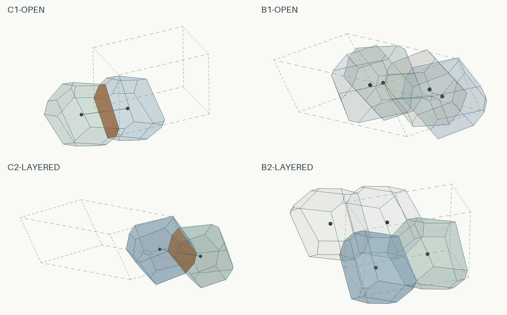
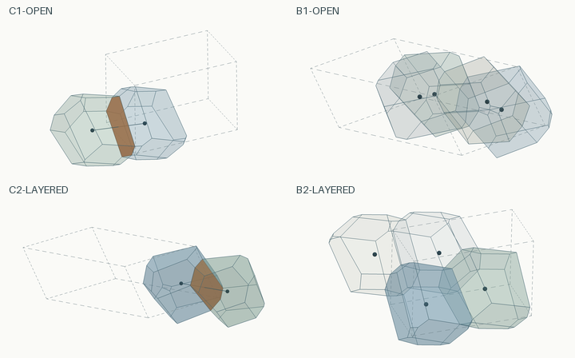
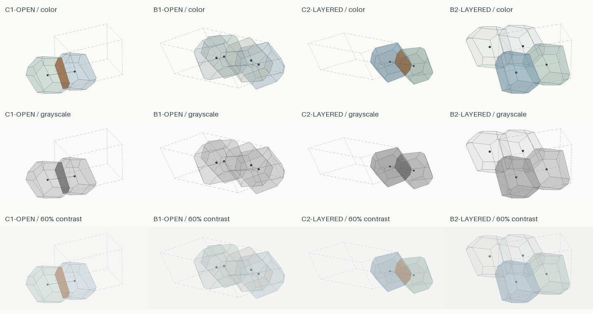

# Round two: translucent B/C comparison

**Review candidates, not final assets.** This continues
[draft PR #136](https://github.com/DeloneCommons/pyvoro2/pull/136) and
[#134](https://github.com/DeloneCommons/pyvoro2/issues/134) on the **unchanged
four-site triclinic dataset**. The maintainer requested two refined directions:
the neighboring image-qualified pair (C), and the four-cell assembly (B).
Round-one candidates and their generator remain intact; nothing is selected,
discarded, integrated into the landing page, or approved for merge.

## Side-by-side previews

Each panel below has its original 16:9 composition. C is on the left and B on
the right. GitHub may shrink the wider sheets to fit its content column;
open an image at native size to inspect the stated pixel dimensions.

**Homepage scale: each panel is 800 × 450.**

[](round-2/comparison-800.png)

**Mobile scale: each panel is 360 × 202; the complete sheet is 720 px wide.**

[](round-2/comparison-360.png)

**Full resolution: each panel is 1600 × 900.**

[](round-2/comparison-1600.png)

Individual images, without sheet headings:

| Variant | Full resolution | Homepage scale | Mobile scale |
| --- | --- | --- | --- |
| C1 — Open pair | [1600 px](round-2/c1-open.png) | [800 px](round-2/c1-open-800.png) | [360 px](round-2/c1-open-360.png) |
| B1 — Oblique assembly | [1600 px](round-2/b1-open.png) | [800 px](round-2/b1-open-800.png) | [360 px](round-2/b1-open-360.png) |
| C2 — Layered pair | [1600 px](round-2/c2-layered.png) | [800 px](round-2/c2-layered-800.png) | [360 px](round-2/c2-layered-360.png) |
| B2 — Assembly with depth emphasis | [1600 px](round-2/b2-layered.png) | [800 px](round-2/b2-layered-800.png) | [360 px](round-2/b2-layered-360.png) |

## Critical comparison

**C1 — Open pair.** Blue and sage faces at 18% opacity give the two cells
volume without concealing the site connector or shared interface. The camera
shows a broader face than round-one C, and automatic framing makes the cells
larger while retaining the complete lattice outline. This is the clearest
scientific explanation and my preferred overall balance. Its weakness is the
large region occupied by the lattice above the pair; the shared face is still
foreshortened, and some rear edges overlap it.

**C2 — Layered pair.** An opposite-side oblique view and 34%/30% surface
opacity create a stronger sense of depth, with the cells on the right and
lattice context on the left. This is the more sculptural C treatment and a
plausible hero direction. Its tradeoff is that overlapping faces and stronger
fill make the two complete cells harder to separate at mobile size; the
connector is less immediate than in C1.

**B1 — Oblique assembly.** A new oblique camera and uniform 16% opacity reveal
all four sites and many internal boundaries; the lattice can be followed
through the assembly. This feels more spatial and less block-like than the
opaque round-one B. Its weakness is competing information: several rear edges
cross the same central region, and projected sites come close together.
At 360 px, it is harder to count four separate cells than in B2.

**B2 — Assembly with depth emphasis.** A lower camera and deliberately unequal
display opacity give cells 40 and 10 more presence, while 70 and 20 recede.
All four sites are well separated in projection, and the lighter cells expose
the lattice and internal structure. This is my preferred B variant. It remains
busier than C1, and the faint cells become primarily outlines under reduced
contrast; opacity must not be interpreted as a scientific measurement.

**Recommendation for review:** C1 if explaining the periodic-image contact is
the main job; B2 if showing the full four-cell tessellation matters more. C2
is worth retaining as the more sculptural pair option. None is a final
selection, and no final polishing or cleanup is included in this round.

The current dataset is usable, so no input change was needed. If the maintainer
still finds these too busy or insufficiently distinctive, a later, separately
requested exploration could compare two deterministic alternatives: a four-site
layout with a larger nonzero-shift contact face visible at a low oblique angle,
and a six-site layout with more balanced cell aspect ratios and less projected
edge overlap. These are proposals only, not computed or validated datasets.

## Captions and alt text

**C1/C2 caption:** Two complete Voronoi cells share the highlighted face:
`(40, 10, (-1, 0, 0))`. Cell 10 and its site are translated by
`(-1, 0, 0) @ vectors = (-2, 0, 0)`. Dashed lines show the triclinic lattice;
solid lines show cell edges and the site connector.

**C1 alt text:** Two softly colored translucent Voronoi cells meet at a copper
polygon. A line connects their sites through that face. A dashed skew lattice
outline extends behind them. The cells are site 40 and the minus-first-vector
image of site 10.

**C2 alt text:** An oblique view of the same image-qualified cell pair, with
stronger translucent surfaces on the right and the dashed lattice on the left.
The copper polygon is their genuine shared face, not a lattice wall.

**B1/B2 caption:** Four complete cells from the original fully periodic
triclinic computation, retaining external IDs 40, 10, 70, and 20. Translucent
faces reveal sites and internal structure through the dashed lattice outline.
No periodic interface is specially highlighted in B.

**B1 alt text:** Four translucent Voronoi polyhedra form an oblique assembly.
Their four site markers and internal edges are visible through the faces.
A dashed skew parallelepiped extends to the left and through the assembly.

**B2 alt text:** Four complete Voronoi cells with two stronger blue-green fills
and two faint fills. All four site markers are separated in the view. Solid
cell edges cross a dashed triclinic lattice outline; cells extend beyond it.

## Scientific and rendering controls

- The original public-API computation and **all documented scientific checks**
  are reused from [render_landing.py](../render_landing.py). Inputs must match
  round one exactly. Returned sites, volumes and selected-face coordinates
  must agree within `1e-12` absolute tolerance; the observed differences here
  were zero. The library source, point set, lattice and external IDs did not
  change.
- B uses the four returned cells in their returned coordinates, including
  remapped site 20. C uses returned cell 40 and the entire returned cell 10
  translated by the documented integer image shift. No clipping, shrinking,
  exploding, smoothing, independently rewrapped sites, or invented walls.
- Transparent copies of a shared polygon would accumulate opacity. The tool
  therefore matches **image-qualified face relationships** and draws each
  coincident interface once, retaining every geometric polygon. B has 56 face
  contributions, five shared interfaces and **51 displayed polygons**. C has
  28 contributions, one shared interface and **27 displayed polygons**. The
  existing reciprocal-vertex checks validate those matches first. Complete
  cell-edge networks remain visible.
- The first encountered face supplies a shared polygon's ordinary display
  material; in C the shared face instead has copper color and 86% opacity.
  All such opacity/color choices are display parameters, not material density,
  volume, weights or another scientific quantity.
- VTK depth peeling orders translucent layers. The script asserts that the
  renderer actually used it; it does not silently publish a fallback alpha
  render. Matte lighting has no specular highlights. No artificial shadow
  plane, background geometry or decorative substitute mesh is added.
- An orthographic camera fits the projected extents of **all** displayed cell
  vertices and all lattice corners, with an 8% margin on each limiting edge.
  The render is supersampled at 3200 × 1800 and reduced to 1600 × 900, then
  800 × 450 and 360 × 202. This changes only sampling, not geometric shape.
- Site markers have a display radius of 0.032. Dashed lattice lines are
  visually subordinate to solid cell edges and colored surfaces. There are no
  small embedded labels that would become unreadable on mobile.

## Small-scale inspection

[](round-2/small-scale-review.png)

The actual 800 px and 360 px images were inspected, along with the grayscale
and reduced-contrast sheet. C's stronger shared-face fill remains identifiable
without color. B2 separates the sites and cells better than B1, while B1 shows
more oblique internal structure. Lattice dashes and fine rear edges weaken at
mobile/reduced contrast; there is no claim of full color-vision testing,
whole-page accessibility approval, or dark-theme integration. The background
is the same opaque warm white as round one.

## Reproduction and evidence

Use the unchanged offline environment in
[requirements.txt](requirements.txt) and the
[round-one setup instructions](README.md#reproduce). From the repository root:

```bash
MPLCONFIGDIR="$PWD/work/mpl" XDG_CACHE_HOME="$PWD/work/cache" \
  VTK_DEFAULT_OPENGL_WINDOW=vtkEGLRenderWindow \
  python tools/render_landing_refined.py
```

This writes `tools/landing-exploration/round-2/`. Use `--output work/round-2-copy`
for an independent reproduction, or `--only c1-open` (and the other scene names)
for a single study in a separate output directory. No render dependency was
added to the library, documentation build, `[all]`, or CI.

[checks.json](round-2/checks.json) records scientific residuals, displayed cell
IDs/image shifts, shared-interface counts, camera transforms, opacity, colors,
observed depth-peeling support, dependency/OpenGL versions and generator/image
hashes. The numerical library remains based on
`9788f4e487e04b660c290a94daa83de9b5c1e16f`; round two started from PR commit
`67ce90b34a36f8919fd419e33c8c858a4a3140f8`. Attribution and licensing are unchanged
from [round one](README.md#scientific-provenance).

Executed checks:

```bash
python tools/render_landing_refined.py
python tools/render_landing.py --check-only
python -m flake8 tools/render_landing.py tools/render_landing_refined.py
python -m pytest -q tests/integration/test_documentation_examples.py \
  tests/forward/spatial/test_periodic_face_shifts.py
zensical build --clean --strict
git diff --check
```

The four original volumes still sum to **3.0**. All **56 oriented faces** pass
the existing bisector and reciprocal-geometry checks; the selected periodic
contact, finite image-stencil check, connector-interior check and independent
tetrahedral volumes pass. **Seven focused tests pass**. Rendering asserts depth
peeling for each scene. Lint and the **strict Zensical build pass** ("No issues
found"). A separate second render produced byte-identical copies of all
**16 PNGs and `checks.json`** in this environment; every recorded hash matches.
Each full-resolution scene has more than 20 px clearance from every canvas
edge. Source PNG sizes are approximately C1 142 KiB, B1 250 KiB, C2 142 KiB,
and B2 209 KiB. Full-suite, notebook, distribution and remote-CI checks
are outside this rendering-only round; no new success is claimed for them.

Environment: Python 3.12.14, PyVista 0.46.4, VTK 9.5.2, EGL/Mesa llvmpipe.
Exact raster bytes can differ on other graphics drivers. A renderer without
working depth peeling will stop with an assertion instead of silently changing
the intended transparent appearance. This remains a static, optional offline
workflow, independent of the normal documentation build.
