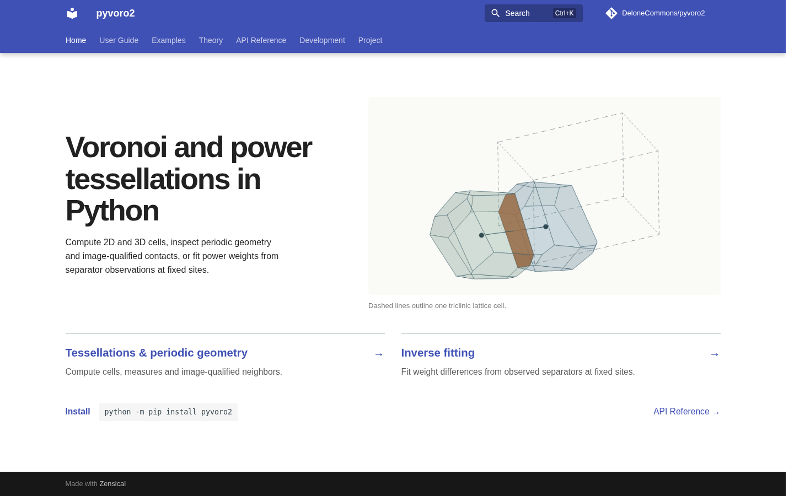
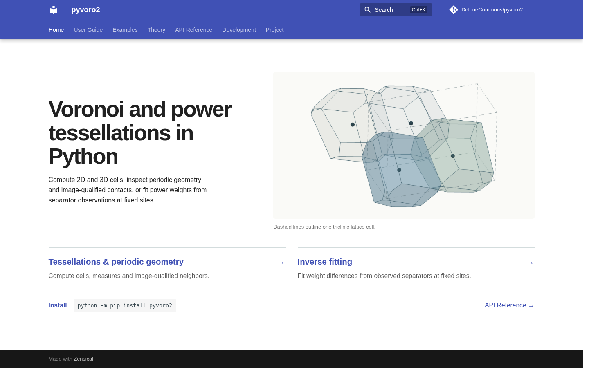
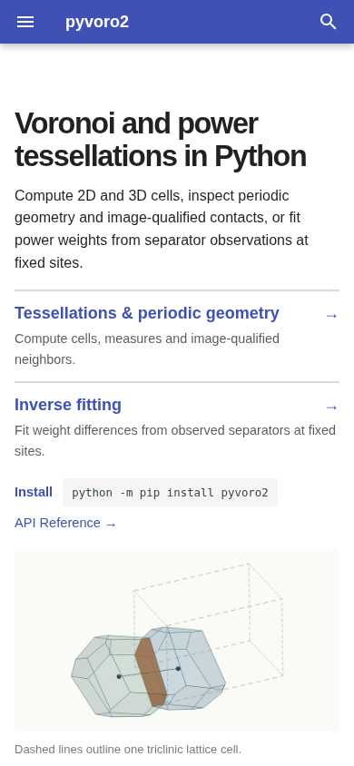
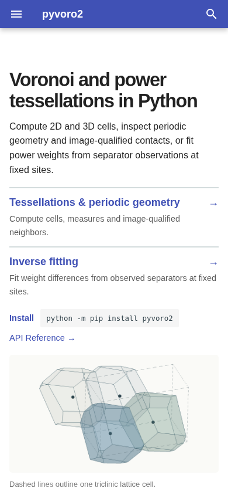

# Choosing a hero in the classic documentation theme

The maintainer approved C1-open and B2-layered for this comparison. These browser captures show each round-two illustration in the proposed opening of the pyvoro2 homepage. Both directions remain under review in [draft PR #136](https://github.com/DeloneCommons/pyvoro2/pull/136).

| Desktop · 1440 × 900 | Desktop · 1440 × 900 |
| --- | --- |
| [](screenshots/desktop-c1-open.png) | [](screenshots/desktop-b2-layered.png) |
| **C1-open** · periodic contact | **B2-layered** · four complete cells |

| Mobile · 390 × 844 | Mobile · 390 × 844 |
| --- | --- |
| [](screenshots/mobile-c1-open.png) | [](screenshots/mobile-b2-layered.png) |

**Recommendation for the homepage.** B2-layered gives the opening headline a visual counterpart at desktop size. The four cells occupy the height of the text block, and the four site markers remain distinct at phone size. The overlap makes individual interior edges harder to trace on mobile. C1-open gives the clearest account of a specific periodic contact. Its copper face is the first detail the eye finds, even on a phone, but the pair sits low in the image and the faint lattice above it carries little visual weight opposite the large headline. The choice turns on whether the opening should introduce the tessellation as a whole or identify a particular shared face. A final caption can explain the chosen figure's scientific point.

**Scale and hierarchy.** The browser fit each complete 16:9 source into approximately 638 × 359 CSS pixels on desktop and 358 × 201 on mobile. The same layout puts the headline beside the figure on desktop. On mobile the reader sees the introduction, both workflow links, the installation command and API shortcut before the image. The final mobile heading wraps onto two lines, leaving room for the complete image and a common one-line lattice caption. Fine lattice dashes remain secondary in both views. The illustrations retain the original framing and materials.

**How to reproduce.** From the repository root, use the existing docs environment with Zensical on PATH and the editable pyvoro2 build. For the offline capture step, use a Python interpreter with Playwright and Pillow installed and a local Chromium executable. The capture here used Zensical 0.1.2, Playwright 1.62.0, Pillow 13.0.0 and Debian Chromium 155.0.8059.79. The script builds a temporary copy of the site with the repository's classic theme, seven navigation tabs, responsive header, search assets and project stylesheet. It generates the second local page from the first by substituting the image file and its descriptive alternative text. External requests are blocked during capture, so the browser uses the theme's local font fallback. Captures use light mode, one device pixel per CSS pixel, and the top of the page.

```bash
python tools/landing-exploration/home-study/capture.py \
  --keep-preview /tmp/pyvoro2-home-preview
python -m http.server --bind 127.0.0.1 --directory /tmp/pyvoro2-home-preview 8000
```

Open /index.html for C1 and /b2.html for B2 on the local server. Supply a fresh directory for each --keep-preview run. Omitting that option retains just the four screenshots. The review files live under tools, outside the published documentation.

**Checks executed.** The temporary site passed the strict Zensical build. For each viewport, the script checked the displayed aspect ratio, horizontal overflow, and the bounding box of the pixel difference between screenshots. Every changed pixel fell inside the illustration. The source PNG hashes matched the round-two manifest. Running the original generator with --check-only verified total volume 3.0, all 56 oriented faces, reciprocal geometry and the highlighted connector crossing. Seven focused documentation-example and periodic-face tests passed.
