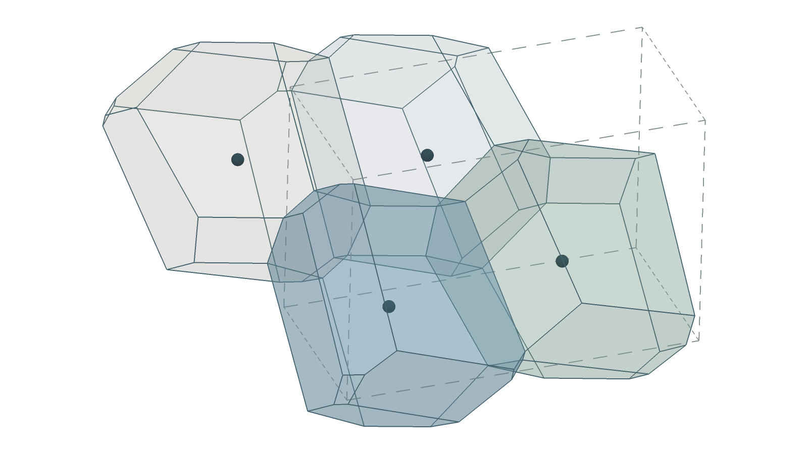

# Triclinic Voronoi hero

[](../../docs/assets/landing/triclinic-voronoi.png)

**Assets** `docs/assets/landing/triclinic-voronoi.png` (Light) and
`docs/assets/landing/triclinic-voronoi-dark.png` (Carbon): 1600 × 900 RGBA,
shared by Home and User Guide.
The maintainer selected B2-layered in [PR #136](https://github.com/DeloneCommons/pyvoro2/pull/136).
The final pass raised the face opacity of cells 70 and 20 from 9% to 14%
and increased the assembly's frame occupancy from 84% to 88% along the limiting
dimension. The original B2 orthographic viewing direction and edge styles
carry through. At 360 px the four sites remain distinct and the dashed lattice
recedes behind the solid cell edges. Some interior edges overlap in projection.

**Caption proposal.** Four complete Voronoi cells in a fully periodic triclinic
lattice. Their volumes sum to the volume of one lattice cell (3 cubic units).
The dashed lines outline its fundamental parallelepiped.

**Alt-text proposal.** Four translucent Voronoi polyhedra surround four dark
site markers. Blue and green foreground cells overlap two paler cells. Solid
cell edges extend across the dashed outline of a skew lattice cell.

## Geometry and provenance

The [forward guide](../../docs/guide/forward/index.md) supplies the four
fractional sites, external IDs 40, 10, 70, 20 and row lattice vectors.
The generator multiplies fractional coordinates by the row matrix and calls
public `pyvoro2.compute` in standard mode. Each polyhedron uses the site and
vertices returned together for its external ID, including the remapped site
20. Polygons retain their Cartesian positions on both sides of the lattice
outline. Coincident interfaces between displayed cells are drawn once,
using their image-qualified neighbors (56 oriented faces, 51 drawn polygons).
Colors, opacity and marker sizes are illustrative.

[Reference data](reference.json) retain the checked input, returned sites,
volumes and reference contact polygon from the reviewed example on pyvoro2
revision `9788f4e487e04b660c290a94daa83de9b5c1e16f` (0.9.0.dev0).
The generator checks nonempty cells and the volume sum, reconstructs each
volume from its polygons, tests every face's bisector and translated reciprocal
vertex set, and checks the reference contact `(40, 10, (-1, 0, 0))` against
neighbor images in the finite stencil and for an interior connector crossing.
B2 gives each interface the ordinary surface treatment.

[Render record](provenance.json) contains the measured residuals, camera,
opacity, renderer, dependency versions and SHA-256 hashes of the PNG and
generator. The [generator](../render_landing.py) specifies the lighting, line
weights, depth peeling and supersampling. This repository-authored illustration
and generator use LGPL-3.0-or-later under [LICENSE](../../LICENSE).
Voro++ attribution is in [NOTICE.md](../../NOTICE.md) and
[LICENSE.voro++](../../LICENSE.voro++).

## Reproduction

From the repository root at the asset commit, use a C++17 toolchain and a
Python 3.12 environment (recorded run: 3.12.14, Linux, EGL/Mesa llvmpipe).
Install the pinned packages into a dedicated offline-rendering environment.

```bash
python3.12 -m venv work/hero-venv
. work/hero-venv/bin/activate
python -m pip install -r tools/landing/requirements.txt
CC=gcc CXX=g++ python -m pip install -e .
python tools/render_landing.py --check-only
MPLCONFIGDIR="$PWD/work/mpl" XDG_CACHE_HOME="$PWD/work/cache" \
  VTK_DEFAULT_OPENGL_WINDOW=vtkEGLRenderWindow \
  python tools/render_landing.py --output work/hero.png > work/hero-record.json
sha256sum work/hero.png docs/assets/landing/triclinic-voronoi.png
```

Without `--output`, the generator writes the production PNG. The check-only
path uses pyvoro2 and NumPy. Rendering requires a VTK backend with working
depth peeling. The normal Zensical build consumes the committed static PNG.
On the recorded stack two independent runs produced identical PNGs and
records. Other graphics drivers can produce different raster bytes.

## Historical Carbon introduction (DOC-W4-C2)

The maintainer selected Carbon / Graphite editorial in PR #141. At that stage, the light B2
and inverse PNGs were unchanged, including their exact bytes. The production
variants are `triclinic-voronoi-dark.png` (1600 × 900) and
`separator-cycle-dark.png` (820 × 444), alongside the light assets. Native
Zensical `#only-light` / `#only-dark` image selection controls their visibility.

The dark B2 uses the same four complete polyhedra, site IDs, vertices, faces,
periodic-image shifts and orthographic camera. Its original opaque `#242728`
background matched Carbon. Pale neutral edges (5.6 supersampled pixels) and a quieter
dashed lattice (4.4 pixels) retain distant structure at mobile size. Slightly
higher face opacity separates the four cells; lighting, site radius and camera
are unchanged. No clipping, inversion or substitute geometry is used.

The inverse generator retains the three fixed sites and original inconsistent
fraction observations. It fits weights, computes actual power cells, checks the
fit status and observation residuals, reconstructs polygon areas, checks unit
area and verifies all three realized contacts. The dark variant changes only
presentation: muted cell fills, pale computed boundaries and warm observation
marks. The two original panel titles remain unchanged. Both inverse PNGs have
transparent backgrounds. The fitted boundaries are not observation marks.

[Production provenance](production-provenance.json) records both themes' exact
render parameters, dependency versions, PNG and generator hashes, raw geometry
hashes and scientific assertions. The two themes have identical raw geometry
hashes, also checked against the previously reviewed `5c41b85` generators. The
older [light B2 record](provenance.json) is retained as historical provenance;
its old generator hash and Pillow version describe that original run.

```bash
# Inside the dedicated rendering environment described above:
python tools/render_landing.py --theme dark --check-only
python tools/landing/render_separator_cycle.py --theme dark --check-only
VTK_DEFAULT_OPENGL_WINDOW=vtkEGLRenderWindow \
  python tools/render_landing.py --theme dark > work/hero-dark-record.json
python tools/landing/render_separator_cycle.py --theme dark > work/inverse-dark-record.json
# Eight renders in temporary files; no committed PNG is overwritten:
MPLCONFIGDIR="$PWD/work/mpl" XDG_CACHE_HOME="$PWD/work/cache" \
  python tools/landing/verify_assets.py --records work/reproduced
```

`--theme light` is the default; `--output PATH` redirects either renderer.
Each rejects the other theme's production path, including symlink resolution.
Do not use Python `-O`: the offline scientific assertions must execute.
That opaque production run used Pillow 13.0.0 and reproduced the
approved Pillow-12 light B2 bytes exactly. Eight independent renders (two per
asset) matched the committed files and each other's records. Raster bytes may
vary on other graphics stacks; geometry assertions must still pass.

All rendering remains optional and offline. Neither the normal Zensical build
nor pyvoro2 runtime depends on VTK, PyVista or these scripts. Earlier candidate
screenshots and provisional render records remain available in
[the C2-1 commit](https://github.com/DeloneCommons/pyvoro2/tree/5c41b8593a3338e3798c2731976e53d2bde8f18f/review/w4-c2).

## Transparent shared B2 pair (#146)

The two canonical B2 PNGs now use native VTK alpha. The approved Light and
Carbon colors, opacity, lighting, four complete cells and camera are unchanged.
Home and User Guide still select those same two paths with native theme variants.
The inverse PNGs are unchanged. The
[opaque production record at the baseline](https://github.com/DeloneCommons/pyvoro2/blob/fe2f3b085a321ba88098a607b892693e82eadd1e/tools/landing/production-provenance.json)
and the historical `provenance.json` describe the earlier files; the current
`production-provenance.json` describes the transparent pair.

`transparent_background=True` alone is insufficient: VTK's RGB already includes
the renderer background and uses premultiplied alpha. The generator clears to
transparent black, captures RGBA with verified depth peeling and MSAA disabled,
averages each 2×2 block in floating premultiplied RGBA, then divides RGB by alpha
to encode standard straight-alpha PNG. Zero-alpha pixels remain zero. Native
alpha is only area-averaged and quantized to 8 bits; it is never inferred from
color, thresholded or otherwise retouched. Geometry is never clipped or altered.

Positive area-filter weights avoid coverage overshoot. The former Lanczos filter
has negative lobes; applying it to RGBA can introduce clipped coverage and edge
ringing. Pillow's intermediate 8-bit premultiplied resampling also clips color.
The new filter retains 2× supersampling without either problem.

`verify_assets.py` additionally runs `check_alpha.py`. Its independent analytical
two-layer scene checks depth order in both actor insertion orders. The actual
B2 scene is rendered over black, white and the former theme backgrounds:
native alpha must match background transmittance, and straight-PNG compositing
must reproduce independently area-filtered opaque captures within two 8-bit
levels per channel, including edges and overlaps. The recorded maxima are below
one level for both themes. Unused pixels, fractional coverage and opaque pixels
are checked explicitly. The scientific checks and eight repeat renders still
verify exact production bytes, raw geometry hashes and the approved camera.

```bash
VTK_DEFAULT_OPENGL_WINDOW=vtkEGLRenderWindow \
  python tools/landing/check_alpha.py
```

[Browser evidence](../../review/b2-transparency/README.md) compares the approved
opaque files with the transparent candidates in both pages and themes at 1366,
390 and 320 px. Final maintainer acceptance remains separate from these checks.
